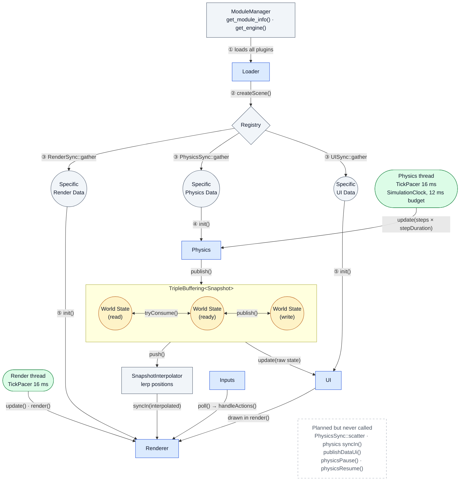

# Core architecture

- **Blue**: plugins loaded from `plugins/` by `ModuleManager`.
- **Grey**: Core classes and data.
- **Green**: the two Core threads, each paced by a `TickPacer`. The render thread sets `is_running = false` when the window closes, which stops the physics thread.
- **Yellow**: the triple buffer shared by the two threads. Only the `ready` index is atomic, with a fresh bit.
- **Steps ① to ⑤**: initialization order. ① to ④ run on the main thread in `initializeCore()`, ⑤ at the start of the render thread.
- **Dashed box**: methods that exist in Core or in the interfaces but are never called. The registry is never updated after loading, and UI settings never reach Core.
